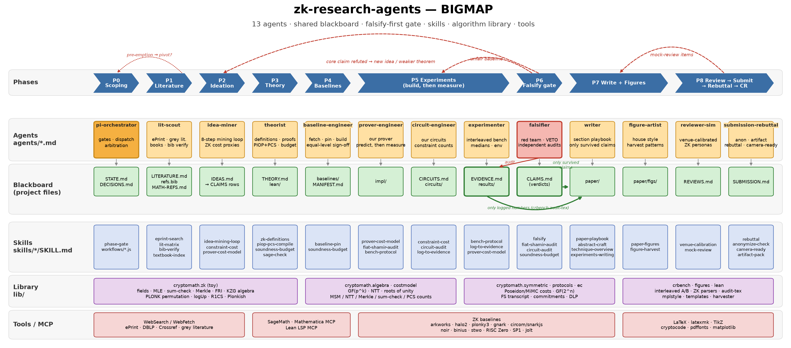

# zk-research-agents

**A multi-agent research system for zero-knowledge proof papers.** It covers three kinds of ZK paper
(protocol / theory, systems / implementation, application / circuits) and takes a project from the literature
search to the camera-ready version. It ships as Claude Code agents, skills and slash commands, and installs for
OpenAI Codex as skills and custom subagents. Alongside them are a toy ZK algorithm library, a fair-benchmarking harness, a figure kit and a
complete worked example.

This is a ZK-only fork of [crypto-research-agents](https://github.com/acprk/crypto-research-agents). It keeps the
upstream process: the blackboard files, falsify-first, the evidence ledger and the P0–P8 gates. The FHE, lattice and
symmetric-cipher content is replaced with ZK content: soundness budgets, Fiat–Shamir and circuit audits, constraint
and prover cost models, ZK baselines and reading lists.

[中文说明](docs/zh/README.md) · [BIGMAP](docs/BIGMAP.md) · [Quickstart](docs/QUICKSTART.md) ·
[Case study](case-study/WALKTHROUGH.md) · [Changelog](CHANGELOG.md)



## Why

Most ZK papers that fail do so because of process, not ideas. Typical causes:
- a soundness level that mixes proven and conjectured terms;
- a speed-up measured against a baseline at a different security level or with a different timing scope;
- a circuit that is under-constrained;
- a Fiat–Shamir transcript that leaves the statement out;
- a number nobody can trace to a log;
- a reference that does not exist.

This repo encodes a process that makes those failures hard to commit:

- **Falsify first.** Every idea becomes a falsifiable row in `CLAIMS.md`. The `falsifier` agent has a veto and
  attacks each claim before any prose is written. Only `survived` claims, or `weakened` ones in their weakened
  wording, may enter the paper.
- **Every number has a log.** Each number in the paper needs an `EVIDENCE.md` row (command, log, commit, machine,
  runs). `crbench audit-tex` blocks any number that has no row.
- **Every security level is accounted for.** Each parameter set gets a soundness-budget table that keeps proven and
  conjectured terms apart and states which security-level definition it uses. The falsifier recomputes it
  independently.
- **Every reference exists.** `bib-verify` checks each bib entry against DBLP, Crossref and ePrint, and checks URLs
  for grey literature.
- **Builders don't judge their own work.** Circuit and Fiat–Shamir audits run twice: once as the builder's self-check,
  then again independently by the falsifier, and only the second one counts.
- **Agents talk through files.** A shared blackboard makes every hand-off explicit and auditable.

## How it works

A project is a directory of **blackboard files**. Each file has one owning agent:

| File | Owner | Holds |
|---|---|---|
| `STATE.md` | pi-orchestrator | thesis, paper type, venue, deadline, current phase, gate checklists |
| `LITERATURE.md`, `refs.bib`, `MATH-REFS.md` | lit-scout | related-work matrix, verified bibliography, math references |
| `IDEAS.md` | idea-miner | mined ideas with cost-model estimates |
| `CLAIMS.md` | (all propose, falsifier rules) | every claim that may enter the paper, with its verdict |
| `THEORY.md` | theorist | definitions, lemmas, proofs, soundness-budget table |
| `CIRCUITS.md` | circuit-engineer | circuits, arithmetization, constraint counts, audit status |
| `EVIDENCE.md` | experimenter | paper number → command → log → commit → machine → runs |
| `DECISIONS.md`, `REVIEWS.md`, `SUBMISSION.md` | pi-orchestrator, reviewer-sim, submission-rebuttal | decisions, mock reviews, submission checklist |

Work moves through **nine phases**. Each phase ends at a gate that
`skills/phase-gate/scripts/gate_check.py` checks mechanically: boxes ticked, every claim ruled on, every number in
the paper backed by an EVIDENCE row.

| Phase | Lead agent | Gate (abridged) |
|---|---|---|
| P0 Scoping | pi-orchestrator | one falsifiable thesis; paper type decides which agents are needed |
| P1 Literature | lit-scout | ≥ 15 verified works incl. the true competitors; pre-emption checked |
| P2 Ideation | idea-miner | ≥ 1 idea with a cost-model gain, registered as claims |
| P3 Theory | theorist | lemmas checked on small parameters; proofs complete; soundness budget |
| P4 Baselines | baseline-engineer | strongest baseline pinned and reproduced at equal soundness |
| P5 Experiments | experimenter | protocol fixed first; interleaved runs; every proof verified; EVIDENCE rows |
| P6 Falsification | falsifier | no `open` claims; circuit and FS audits passed; budget recomputed |
| P7 Writing + figures | writer, figure-artist | every number ↔ EVIDENCE, every claim ↔ verdict |
| P8 Review → submit | reviewer-sim, submission-rebuttal | mock-review items closed; bib clean; anonymised |

A failed falsification sends work back: a refuted claim returns to P2 or P3, a broken circuit or transcript returns
to P5. The full table is in [workflows/PHASES.md](workflows/PHASES.md).

## Install

```bash
git clone https://github.com/FranklinZty/zk-research-agents.git ~/zk-research-agents
cd ~/zk-research-agents
pip install -e lib/cryptomath -e lib/bench            # Python ≥ 3.10
./install.sh ~/papers/my-paper                        # or: ./install.sh --user   (all projects)
```

`install.sh` copies the agents, skills and commands into `<project>/.claude/`, and the workflow scripts into
`<project>/.cra/workflows/`. Pass `--link` to symlink instead of copy. To use it as a Claude Code plugin instead,
run `claude plugin install <path-or-url>`.

**Codex.** Add `--codex` (`./install.sh ~/papers/my-paper --codex`, or `--user --codex`). The skills go to
`.agents/skills/`, and each slash command becomes a skill of the same name, so in Codex you type `$cra-init`,
`$cra-phase P3` and so on. The 13 agents become Codex custom subagents in `.codex/agents/*.toml`. The rest of this
README uses Claude Code's `/cra-…` spelling; under Codex read it as `$cra-…`. The heavy multi-agent rounds in
`workflows/*.js` need Claude Code; under Codex, ask for the same subagents by name. See `AGENTS.md`.

Optional tools are used when present:
- the ZK toolchains you compare against: Rust, Go, circom / snarkjs and noir, pinned with
  `references/baselines/fetch.sh`;
- SageMath;
- Lean 4 + Mathlib;
- `latexmk` with cryptocode;
- Node ≥ 18.

The two reference books are downloaded to a local cache and never committed: run `references/books/fetch.sh`.

## Tutorial: a first project

This walk-through follows a small systems / application question from start to submission. The finished version of
this exact project is in [case-study/toy-rangecheck](case-study/WALKTHROUGH.md), with all of its blackboard files,
logs and the paper; read it alongside this tutorial.

> **Question.** Our circuit spends most of its constraints on range checks. Is a logUp lookup with 8-bit limbs
> cheaper than bit decomposition, and by how much?

Agents run the commands and fill in the files. Your job is to make the decisions and review each gate.

### Step 0: scope (P0)

```bash
./install.sh ~/papers/rangecheck && cd ~/papers/rangecheck && claude
```
```
/cra-init .
```
The orchestrator creates the blackboard and the `paper/` skeleton, then asks you four things:
- **Thesis**: one falsifiable sentence, e.g. *"For n = 64 values over Goldilocks, logUp with 8-bit limbs is at
  least 5× cheaper than bit decomposition in rows and prover time for every k ≤ 64."* It is fine to start too
  strong; P6 will cut it down to what is true.
- **Paper type**: this one is *application*. A protocol / theory paper runs without prover-engineer and
  circuit-engineer.
- **Target venue**.
- **Deadline**.

Run `/cra-status` at any time to see the phase, open claims and the next actions.

### Step 1: literature (P1)

```
/cra-lit "lookup arguments for range checks"
```
lit-scout searches ePrint and the grey literature (project docs, ethresear.ch, HackMD), then fills the
related-work matrix with these columns: arithmetization, PCS, setup, assumptions, PQ, field, P/V/π, numbers and
code. Every entry is checked by `bib-verify`, and the curated lists in `references/reading-lists/` seed the search.
**Review:** are the 2–4 true competitors in the matrix? Has someone already done this?

### Step 2: ideas and claims (P2)

```
/cra-ideas "range checks dominate the constraint count of our circuit"
```
idea-miner runs the 8-step mining loop. It estimates each idea's cost with `constraint-cost` (rows, columns, lookups)
and `prover-cost-model` (MSM, NTT, hashing, sum-check) before anything is built. Promising ideas are written into
`CLAIMS.md` as precise rows with a parameter range. **Decide:** which ideas to pursue.

### Step 3: theory and soundness (P3)

```
/cra-phase P3
/cra-soundness "toy multilinear Plonkish argument, Goldilocks, both arms"
```
The theorist does three things:
- fixes the security notion with `zk-definitions`;
- checks every lemma by brute force over small fields with `sage-check`;
- computes the soundness budget term by term, proven terms kept apart from conjectured ones, stating whether the
  level is worst-case or average-case.

The falsifier then rebuilds the budget without looking at the theorist's numbers. When the claims are about
hash-based components, cite Chiesa–Yogev (see the [chapter map](references/books/hash-snargs/MAP.md)); for algebraic components, cite Thaler (see the
[chapter map](references/books/thaler/MAP.md)).

### Step 4: baselines (P4)

```
/cra-phase P4
```
baseline-engineer pins the strongest competitor at a full commit SHA and reproduces its published numbers. It then
signs off that both sides run at the same soundness level, with the same statement and the same timing scope
(witness generation, preprocessing, setup).

### Step 5: build, audit, measure (P5)

circuit-engineer writes the circuits in `circuits/` and prover-engineer writes the prover in `impl/`. Each
self-audits its own work:
```
/cra-circuit-audit circuits/range_gadgets.py C1
/cra-fs-audit impl/toy_prover.py C5
```
Then the benchmark runs:
```
/cra-bench "lookup arm vs bits arm, n = 64, k ∈ {4..64}, 1 core"
```
`crbench` interleaves the A and B runs, captures the environment, verifies every proof that is timed, and writes
an `EVIDENCE.md` row for each number.

### Step 6: falsification (P6)

```
/cra-falsify
```
The falsifier attacks every open claim in this order: definitions, model, Fiat–Shamir compilation, exhaustive
small-parameter checks, recomputation from the raw logs, fairness at equal security, and prior work. Circuit claims
also get an independent exhaustive circuit audit. In the case study this step found three things:
- the planted under-constrained limb, which the builder's random tests had missed;
- a real Fiat–Shamir flaw: sum-check sub-transcripts were not bound to the statement;
- that "5× everywhere" was really 3.7–3.8× for 16 ≤ k ≤ 48.

The refuted claims stay in `CLAIMS.md` with the reason. The paper uses the weakened wording.

For larger projects there is a heavier multi-agent round, which needs Claude Code's Workflow tool:
`Workflow({scriptPath: ".cra/workflows/falsify-round.js", args: {project: "<abs path>"}})`.

### Step 7: write and draw (P7)

```
/cra-write technique-overview
/cra-write experiments
/cra-figure "prover-time ratio vs k, both arms"
```
The writer follows `paper-playbook`. It may only use survived or weakened claims and numbers that have a ledger row,
and the figures use the house style. Before leaving P7, run `make` in `paper/`; `crbench audit-tex` must pass on
every section.

### Step 8: review and submit (P8)

```
/cra-review CRYPTO application
/cra-submit CRYPTO
```
The mock-review panel has five roles: soundness reviewer, implementation-and-benchmark reviewer,
application-and-industry-relevance reviewer, data auditor and desk-reject check. It produces action items, which you
fix. `/cra-submit` then runs anonymisation (including on-chain addresses and package metadata), the page and font
checks, bib-verify and the artifact pack. Nothing is uploaded or sent without your explicit approval.
After reviews arrive: `/cra-rebuttal reviews.txt 700`.

### Checking the gates yourself

```bash
python3 .claude/skills/phase-gate/scripts/gate_check.py --project . --phase P5 --paper paper
```

### Tips
- Keep the thesis falsifiable and let the falsifier shrink it. A precise weakened claim makes a better paper than a
  vague strong one.
- Never edit `EVIDENCE.md` by hand to make a number fit: re-run, and log the new run.
- When the falsifier sends work back, record why in `DECISIONS.md`; the case study's D-5, D-6 and D-9 are examples.
- Items that still need a human check are collected in [docs/NEEDS-VERIFICATION.md](docs/NEEDS-VERIFICATION.md).

## What is inside

| Directory | Contents |
|---|---|
| `agents/` | 13 subagents: pi-orchestrator, lit-scout, idea-miner, theorist, prover-engineer, circuit-engineer, baseline-engineer, experimenter, falsifier, writer, figure-artist, reviewer-sim, submission-rebuttal |
| `skills/` | 34 skills. ZK-specific: soundness-budget, zk-definitions, piop-pcs-compile, fiat-shamir-audit, circuit-audit, constraint-cost, prover-cost-model. Process: eprint-search, bib-verify, lit-matrix, reading-notes, textbook-index, idea-mining-loop, sage-check, lean-bridge, baseline-pin, bench-protocol, log-to-evidence, falsify, phase-gate. Writing and submission: paper-playbook, abstract-craft, technique-overview, related-work-writing, experiments-writing, polish-writing, venue-calibration, mock-review, rebuttal, anonymize-check, camera-ready, artifact-pack, paper-figures, figure-harvest |
| `commands/` | `/cra-init`, `/cra-status`, `/cra-phase`, `/cra-lit`, `/cra-ideas`, `/cra-soundness`, `/cra-circuit-audit`, `/cra-fs-audit`, `/cra-falsify`, `/cra-bench`, `/cra-write`, `/cra-figure`, `/cra-review`, `/cra-rebuttal`, `/cra-submit` |
| `workflows/` | phase playbook P0–P8 with gates, multi-agent Workflow scripts (lit-sweep, idea-tournament, falsify-round, mock-review-panel) and their `node --test` harness |
| `lib/cryptomath/` | toy ZK components (`zk`: small fields, MLE, sum-check, Merkle, FRI, KZG algebra, PLONK permutation / logUp, R1CS, Plonkish), algebra (fields, NTT, polynomials), cost models (MSM, NTT, Merkle, sum-check, PCS), AO-primitive costs, commitments, Fiat–Shamir transcript, small elliptic curves |
| `lib/bench/` | `crbench`: interleaved A/B runs, robust statistics, environment capture, parsers (criterion for arkworks / halo2 / plonky3, gnark, snarkjs / rapidsnark, circom, nargo, RISC Zero, SP1, SAT solvers), LaTeX tables, EVIDENCE ledger, `audit-tex` |
| `lib/lean-template/` | Lean 4 + Mathlib project template |
| `figures/` | house styles (LNCS / ACM / IEEE), 12 matplotlib and 5 TikZ templates (protocol box, PIOP → PCS pipeline, …), figure harvester and pattern catalog |
| `templates/` | blackboard files, LNCS paper skeleton with cryptocode, rebuttal and hand-off templates |
| `references/` | Chiesa–Yogev and Thaler chapter maps and glossary (books fetched locally, cited and paraphrased only), textbook catalog, 8 ZK reading lists (139 verified entries), baseline MANIFEST (25 ZK libraries) |
| `case-study/` | the toy-rangecheck project from the tutorial, run through P0–P8 with real toy measurements |

## Scope and honesty
- The toy implementations in `lib/cryptomath` are **not secure**. They exist to reason, count and sanity-check on
  small parameters.
- Venue page limits and rebuttal budgets in `skills/venue-calibration` are only a guide; always read the current
  CFP.
- The system never sends anything off your machine (submissions, e-mails, public repos) without your explicit
  approval.
- The literature scripts are rate-limited, identify themselves with this repo's public URL in their User-Agent, and
  never work around a block. If ePrint is unreachable they fall back to a mirror, mark those entries
  `VERIFIED (mirror)`, and still cite the canonical URL.
- Facts not yet checked against a source are marked `needs verification`. The full list is in
  [docs/NEEDS-VERIFICATION.md](docs/NEEDS-VERIFICATION.md).

## License
MIT; the upstream copyright notice is kept in `LICENSE`. The reference books are cited and paraphrased only. See
`references/books/README.md`.
