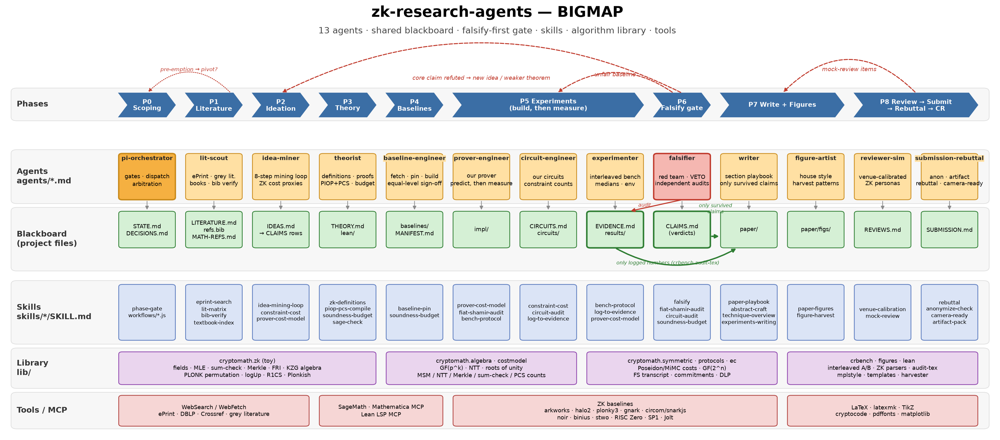
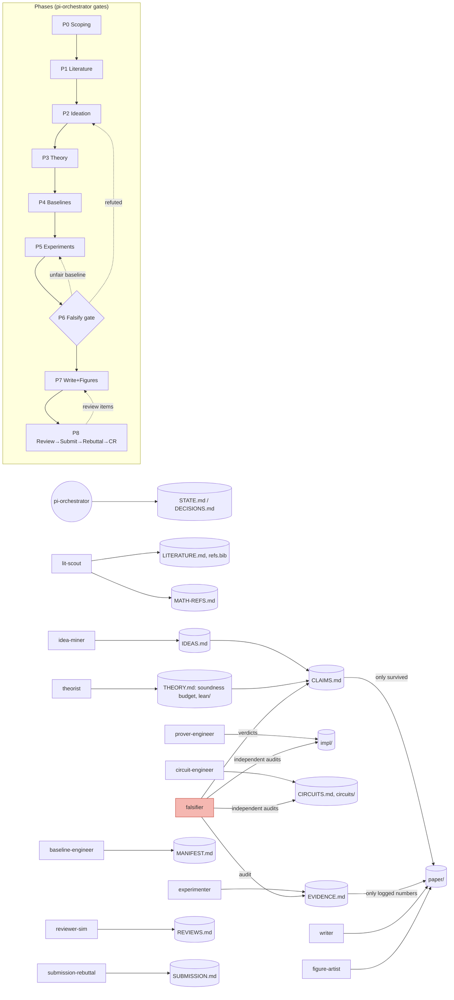

# BIGMAP — the whole system on one page

*(Regenerate: `python3 docs/bigmap/make_bigmap.py` → `bigmap.{png,svg,pdf}`.)*

## 1. Six layers

| Layer | What lives there | Where |
|---|---|---|
| **Phases** | P0 Scoping → P1 Literature → P2 Ideation → P3 Theory → P4 Baselines → P5 Experiments → P6 Falsify gate → P7 Writing+Figures → P8 Review/Submit/Rebuttal/Camera-ready | `workflows/PHASES.md` |
| **Agents** | 13 role-specialised subagents; one owner per phase (11 for a protocol / theory paper, without the two engineers) | `agents/*.md` |
| **Blackboard** | Plain Markdown files inside *your* research project; the only channel agents use to hand off work | `templates/blackboard/` |
| **Skills** | Step-by-step procedures + scripts an agent loads on demand | `skills/*/SKILL.md` |
| **Library** | Python algorithm library (toy ZK components, algebra, cost models, AO-primitive costs, protocols, EC), benchmarking harness, figure kit, Lean template | `lib/`, `figures/` |
| **Tools** | Web (ePrint/DBLP/Crossref, grey literature), SageMath, Mathematica MCP, Lean LSP MCP, ZK baseline toolchains (arkworks, halo2, plonky3, gnark, circom/snarkjs, noir, zkVMs), LaTeX | `references/baselines/MANIFEST.md` |

## 2. The three invariants that make the agents trustworthy

1. **Falsify first.** An idea becomes a *claim* only when it is written into `CLAIMS.md` as a
   precise, falsifiable statement. The `falsifier` attacks it (definitions → model and
   assumptions → Fiat–Shamir → small-parameter checks → recomputation from logs → equal-level
   fairness → literature pre-emption; circuit claims also get an independent circuit audit) *before* anyone writes prose about it.
   Only `survived` (or `weakened`, with the weaker wording) claims can enter `paper/`.
2. **Every number has a log.** No number enters the paper without an `EVIDENCE.md` row
   (command, log path, commit, machine, repeats, statistic). `crbench audit-tex` enforces it.
3. **Every reference exists.** `bib-verify` checks each bib entry against DBLP/Crossref/ePrint;
   unverifiable entries are removed, never "fixed from memory".

## 3. Interaction flow

## 4. Who talks to whom (hand-off contracts)

| From → To | Artifact | "Done" means |
|---|---|---|
| PI → any | task row in `STATE.md` | input files, expected output file, deadline stated |
| lit-scout → idea-miner | `LITERATURE.md` matrix | ≥ 15 verified works, strongest baseline named, pre-emption scan dated |
| lit-scout → theorist | `MATH-REFS.md` rows | each needed fact has book + chapter/theorem number (`[CY24 §…, label]`, `[Thaler §…]`) |
| idea-miner → falsifier | `CLAIMS.md` rows (status `open`) | claim is quantified, parameter range given, kill criterion stated |
| theorist → falsifier | `THEORY.md` + scripts | every lemma checked numerically on small params; soundness budget per parameter set, proven / conjectured apart; Lean status recorded |
| circuit-engineer → falsifier | `CIRCUITS.md` + `circuits/` | counts from compiler output with EVIDENCE rows; builder self-audit recorded (the falsifier re-runs it) |
| prover-engineer → experimenter / falsifier | `impl/` | cost model predicted before implementing; FS transcript self-audit recorded; per-phase timers |
| baseline-engineer → experimenter | `MANIFEST.md` | builds at pinned commit; equal soundness level signed off; published numbers reproduced or discrepancy documented |
| experimenter → falsifier / writer | `EVIDENCE.md` + tables | interleaved, ≥ 3 repeats, medians, env captured |
| falsifier → PI | verdict column | every open claim decided; refutations have a reproducible script |
| writer / figure-artist → reviewer-sim | `paper/main.pdf` | audit-tex clean, 0 undefined refs, figures in house style |
| reviewer-sim → PI | `REVIEWS.md` action items | each item routed to an agent |
| submission-rebuttal → human | `SUBMISSION.md` | checklist green; anonymisation clean; human approves before anything leaves the machine |

## 5. Scope of the library

| Area | Modules | Typical experiment |
|---|---|---|
| Toy proof-system components | `cryptomath.zk` | sum-check soundness measured against v·d/p, Merkle collision extraction, FRI proof size, logUp / permutation checks, R1CS / Plonkish counts |
| Algebra / number theory | `cryptomath.algebra` | NTT-friendly primes, roots of unity, GF(p^k) challenge fields, butterfly counts |
| Cost screening | `cryptomath.costmodel` | count MSM / NTT / Merkle / sum-check / PCS work of two provers before implementing either |
| AO primitives | `cryptomath.symmetric` | Poseidon / MiMC / Rescue-style constraint counts, GF(2^n) arithmetic for binary-field systems |
| Protocols | `cryptomath.protocols` | Fiat–Shamir transcript, hash / Pedersen commitments, Schnorr (HVZK simulator, extractor) |
| Elliptic curves | `cryptomath.ec` | toy curve arithmetic, BSGS / Pollard-rho DLP |
| Benchmarking | `crbench` | fair interleaved A/B on any prover, ZK log parsers, EVIDENCE ledger, LaTeX tables |
| Figures | `figures/` | 12 matplotlib + 5 TikZ templates, harvester for learning figure patterns from local PDFs |
