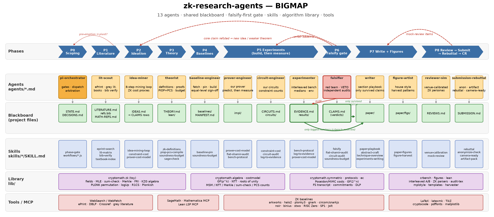

# BIGMAP（中文）

图从上到下六层：

1. **阶段层**：P0 立题 → P1 文献 → P2 idea → P3 理论 → P4 baseline → P5 实验 → P6 证伪闸门 → P7 写作+画图 → P8 审稿/投稿/rebuttal/终稿；红色虚线是回退路线。
2. **agent 层**：13 个 agent，每列对应一个阶段的负责人（P5 列包含 prover-engineer、circuit-engineer 和 experimenter）；橙色为总控 PI，红色为拥有否决权的 falsifier。
3. **黑板层**：研究项目目录中的共享文件。粗框的 `CLAIMS.md` 与 `EVIDENCE.md` 是进入论文的两道闸门——只有 survived 的论断、有日志的数字能进 `paper/`。
4. **skills 层**：每个 agent 按需加载的操作手册与脚本。
5. **算法库层**：`cryptomath`（ZK 玩具组件/代数/代价模型/AO 原语/协议/椭圆曲线）、`crbench`、画图模板、Lean 模板。
6. **工具层**：Web（ePrint/DBLP/Crossref、灰色文献）、SageMath、Mathematica MCP、Lean LSP MCP、ZK baseline 工具链（arkworks、halo2、plonky3、gnark、circom/snarkjs、noir、zkVM）、LaTeX。

交接契约（谁交给谁、什么算“完成”）见英文版 `docs/BIGMAP.md` 第 4 节。
