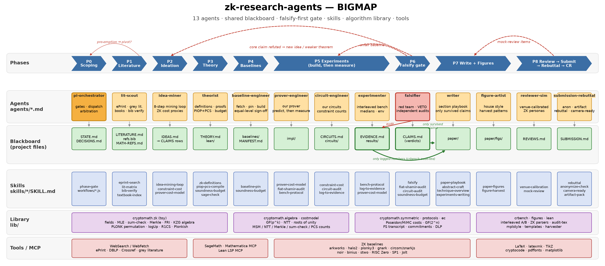

# zk-research-agents（中文说明）

一套**多 agent 协作的零知识证明（ZK）科研系统**，面向三类 ZK 论文：协议/理论、系统/实现、应用/电路。从文献调研、idea 挖掘、理论证明、baseline 复现、
公平实验、证伪审查，到论文写作、画图、模拟审稿、投稿、rebuttal、camera-ready，
全部打包为 Claude Code 的 agents / skills / 斜杠命令（Codex 通过 `AGENTS.md` 同样可用），
并配有 ZK 玩具算法库、公平基准测试框架、画图模板和一个完整的玩具示例。

本仓库是 [crypto-research-agents](https://github.com/acprk/crypto-research-agents) 的 ZK 专用 fork：保留流程骨架（黑板文件、先证伪、证据台账、P0–P8 阶段门禁），把 FHE、格、对称密码的领域内容替换为 ZK 内容（soundness 预算、Fiat–Shamir 与电路审计、约束数与 prover 成本模型、ZK baseline 与阅读清单）。



## 一、设计思想：三条铁律

| 铁律 | 落地方式 |
|---|---|
| **先证伪，再下笔** | idea 必须先写成 `CLAIMS.md` 里可证伪的一行；`falsifier` agent 有一票否决权，按“定义 → 模型与假设 → Fiat–Shamir 编译 → 小参数穷举 → 从原始日志重算 → 等安全级别公平性 → 文献先例（含灰色文献）”的顺序攻击，电路类结论另做独立电路审计；只有 `survived`（或按削弱后措辞的 `weakened`）才能写进论文 |
| **每个数字都有日志** | `EVIDENCE.md` 记录“论文中的数字 → 命令 → 日志路径 → commit → 机器 → 重复次数/统计量”；`crbench audit-tex` 自动检查论文里每个数字 |
| **每条引用都真实存在** | `bib-verify` 逐条对 DBLP / Crossref / ePrint（灰色文献走 URL 校验）核验；查不到的删除，绝不“凭记忆补全” |
| **每个安全级别都有账** | 每组参数一张 soundness 预算表，可证明项与猜想项分开，由 falsifier 独立重算 |

agent 之间**只通过黑板文件交接**（`STATE.md`、`CLAIMS.md`、`EVIDENCE.md`……），因此每一次交接都可追溯、可审计。

## 二、13 个 agent

| agent | 职责 | 对应阶段 |
|---|---|---|
| pi-orchestrator | 阶段门槛、派单、冲突裁决 | 全程 |
| lit-scout | ePrint/DBLP 与灰色文献检索、相关工作矩阵、bib 核验、抢占监控；参考书与教材目录索引（“这个引理在哪本书哪一节”） | P1/P3 |
| idea-miner | 8 步挖掘法 + ZK 成本代理（约束数、prover 成本模型） | P2 |
| theorist | 安全定义、PIOP + PCS 编译、证明、soundness 预算、Sage 数值检验、Lean4 形式化 | P3 |
| prover-engineer | 我们自己的 prover/verifier 实现（`impl/`）：先预测成本再实测，FS transcript 自查 | P5 |
| circuit-engineer | 我们自己的电路（`circuits/`、`CIRCUITS.md`）：约束数、电路自查 | P5 |
| baseline-engineer | 拉取、固定 commit、构建、等安全级别签字 | P4 |
| experimenter | 交错 A/B、中位数、环境记录、证据账本 | P5 |
| falsifier | 红队，一票否决；独立重算 soundness 预算，独立复查 FS 与电路审计 | P6（及随时） |
| writer | 按 playbook 分节写作 | P7 |
| figure-artist | 统一风格作图、从论文中学习好图的模式 | P7 |
| reviewer-sim | 按会议口径模拟 ZK 审稿人（soundness、实现与基准、应用相关性） | P8 |
| submission-rebuttal | 匿名化、清单、artifact、rebuttal、camera-ready | P8 |

各 agent 的中文版见 `docs/zh/agents/`。只做协议/理论的项目可以不启用两个 engineer（实际 11 个 agent）。

## 三、阶段与回退（P0–P8）

P0 立题 → P1 文献 → P2 idea → P3 理论 → P4 baseline → P5 实验 → **P6 证伪闸门** → P7 写作+画图 → P8 审稿/投稿/rebuttal/终稿。

- P6 推翻核心论断 → 回 P2（换 idea）或 P3（弱化定理）
- P6 发现 baseline 不公平或没复现 → 回 P4/P5
- P8 模拟审稿要求补实验 → 回 P5；表述问题 → 回 P7
- 任何时候发现被抢占 → 回 P1 做威胁评估，由 PI 在 `DECISIONS.md` 里决定转向 / 重新定位 / 放弃

详见 `workflows/PHASES.md`。

## 四、算法库覆盖面

- **ZK 玩具组件（`cryptomath.zk`，不安全）**：小域（F_17、F_97、Goldilocks）、多线性扩展、sum-check（含 FS 版本和作弊 prover）、Merkle 承诺、FRI、KZG（仅代数）、PLONK 置换与 logUp lookup、R1CS 与 Plonkish 计数
- **代数/数论**：有限域、GF(p^k) 扩域、NTT 友好素数、单位根、radix-2 / Bluestein NTT（计数蝶形运算）
- **代价模型**：在实现之前先数操作：MSM、NTT、Merkle、sum-check、KZG/FRI 的整数计数和 sympy 符号公式
- **AO 原语与二元域**：Poseidon/MiMC/Rescue 类原语的约束数，GF(2^n) 算术
- **协议**：哈希/Pedersen 承诺、Fiat–Shamir transcript、Schnorr（HVZK 模拟器、特殊可靠性提取器）
- **椭圆曲线**：小曲线运算、BSGS/Pollard rho/Pohlig–Hellman
- **crbench**：交错运行、稳健统计、环境记录、criterion（arkworks/halo2/plonky3）、gnark、snarkjs/rapidsnark、circom、nargo、RISC Zero、SP1、SAT 求解器等日志解析、LaTeX 表格、审计论文数字（约束数、行数、gas、cycles、kB、bits）

## 五、上手

```bash
pip install -e lib/cryptomath -e lib/bench
./install.sh ~/papers/我的新论文
cd ~/papers/我的新论文 && claude
# 然后在 Claude Code 中：
/cra-init .
/cra-status
```

完整示例（玩具课题：Goldilocks 上的范围检查，lookup（logUp，8-bit 分块）对比按位分解；故意埋下一个欠约束的最高分块，由 falsifier 抓出）见
`case-study/WALKTHROUGH.md`，中文版 `docs/zh/case-study-walkthrough.md`。

## 六、经验教训（抽象后的通用版本）

1. **强基线往往不是目标论文自己比较的那个**——先问“真正的最强 baseline 是谁”。
2. **库的默认参数 ≠ 论文里的参数**——对比前核对真实参数。
3. **引用别人的加速比前先在本机复测**；复测不出来就不能直接比较。
4. **测量一律交错运行取中位数**，不用陈旧 build，不和其他任务抢核。
5. **多 agent 协作时，主 agent 先写可证伪文件，要求 subagent 优先推翻**——提出者最容易对自己的论断盲目。
6. **“不可行”也是结果**：边界条件、失败参数要写进论文的局限性说明，而不是藏起来。
7. **rebuttal 以证据回答**：每个回应都指向日志、定理或新实验，字数预算内先答必须回答的问题。
8. **任何对外动作（投稿、邮件、公开仓库、ePrint）都必须人工确认**。
